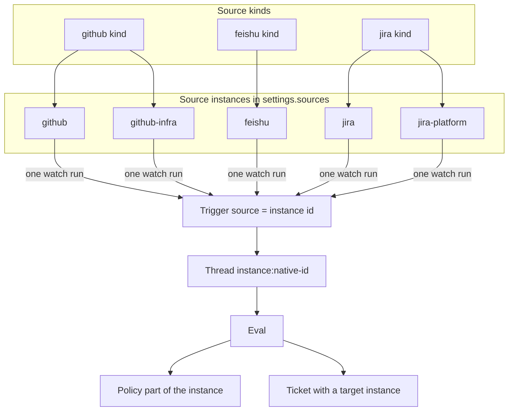

# 010 Source instances

**Status: proposal revised after the PR #5 review. This change contains documentation only. No runtime code changes until the revised architecture is accepted and implementation is scheduled.**

## Summary

Today each Source kind has exactly one configuration. A deployment can watch one GitHub repository, one Jira project and one Feishu bot configuration. Operators need several independent Sources of the same kind: two GitHub repositories, two Jira projects or sites, or two Feishu chat scopes with different policies.

[001 Domain model](001-domain.md) already defines a Source as a kind plus one instance configuration. This proposal makes that model real in the code:

- The **Source instance** becomes the identity used by Triggers, Threads, Channels, Policies, health and state.
- A **Source kind** stays the plugin implementation. Settings store any number of instances of each kind.
- The existing instance of each kind keeps its current id (`github`, `feishu`, `jira`, `gitlab`), and its Triggers, Threads, Policy parts, cursors and health names remain byte-for-byte compatible. No stored record has to be migrated to upgrade.
- New instances use new, immutable ids such as `github-infra` or `jira-platform`. They never reuse an id, including after removal.

The proposal is deliberately generic. Nothing in the registry, settings, policy, health, state or UI may be specific to GitHub or Jira beyond a kind's own plugin code.

The review decisions from PR #5 are incorporated: a coding Ticket chooses a repository target from any repository-capable Source instance, while a non-coding Ticket may run in a local workdir with no repository; Source lifecycle and receiving scope are panel-only; removal is blocked only by a depending open Ticket; the panel offers policy copying and warns about identical scopes. The revised execution-target design is in [Execution target](#execution-target).

## Why this is not a small configuration change

The current single-instance design is not only a UI limitation. These assumptions are spread across the runtime:

| Assumption | Where it appears |
| --- | --- |
| `settings.sources` is keyed by kind and one entry configures the whole kind | `SettingsSchema`, `SourceRegistry.instances`, settings view, policy view |
| `settings.policy.sources` is keyed by kind | gate, allowed lists, admission rows, policy version, policy sync |
| One health entry exists per kind (`github`, `feishu`, `history`, `jira`) | `SourceKind.health`, `HealthBoard`, Source status, overview, status script |
| Source KV records are keyed by kind (`github-since`, `jira-cursor`, …) | `src/kv.ts`, every polling loop |
| One `SourceContext` exists per kind and `config(kind)` reads that kind's entry | `sourceContextOf`, every Source plugin |
| A Source plugin starts exactly one polling loop | plugin `apply` in `github.ts`, `feishu.ts`, `jira.ts`, `gitlab.ts` |
| The deployment has one GitHub repository and one `gh`/`lark-cli` worker identity | `Deployment.repository`, `Commands`, worker shims, execution environment |
| Thread keys are `kind:native-id`, so two repositories would both use `github:12` | Trigger and Thread construction in every kind |
| The worker opens pull requests in the one deployment repository | pull binding, executor tools, `DSH_SUPERAGENT_GITHUB_REPOSITORY` |

A per-kind array such as `github.repositories: [...]` would patch one symptom at a time and still need separate code in every kind. It would also leave policy, health, state, replies and UI keyed by kind. The generic solution is to finish the Source-instance abstraction the domain model already names.

Some changes below are wider than the visible feature: a run lifecycle, per-instance health and state, create/remove, and a reshaped deployment. They are the minimum for a generic capability that keeps one-instance behavior intact. The implementation plan stages them so each phase is reviewable on its own.

## Goals

- Any installed Source kind can have any number of instances.
- Each instance has its own enabled switch, configuration, receiving scope, policy part, health, read state and replies.
- Instances of one kind share no identity: the same GitHub issue number, Jira issue key or Feishu message must not collide across instances.
- Existing single-instance installations upgrade without re-reading events, changing policy or losing cursors.
- Adding, enabling, disabling or removing an instance is a panel operation; it should not require editing machine configuration.
- A new Source kind gets the capability from the framework, not from kind-specific instance code.
- A coding Ticket can target any repository-capable Source instance; a non-coding Ticket can execute in a local workdir with no repository.
- A Ticket may subscribe to repository Threads from several instances as context without changing its one execution target, or its lack of one.
- Future repository kinds such as GitLab can supply execution targets without changing the Engine's target model.

## Non-goals for this proposal

- **Multiple worker accounts or bots per kind.** GitHub and Feishu each have one installation-level worker command (`gh` and `lark-cli`, including the git credential helper and the worker's `lark-cli` shim). Multiple instances of those kinds therefore share that account and bot. [001 Domain model](001-domain.md) says an instance holds its own bot identity; in this version that identity is the installation bot the instance acts through, not a distinct credential. Per-instance worker accounts and bots are a separate change to the execution environment.
- **A second repository kind in this change.** GitHub was the first repository-capable kind. The capability interface was extended separately so GitLab also supplies targets; a future repository kind follows the same interface.
- **More than one execution repository per Ticket.** A Ticket has zero or one target repository. It may subscribe to Threads of several repository instances for context; subscriptions do not add targets.
- **Sharing a Thread or a Ticket between instances.** A Thread belongs to exactly one instance. Related work across instances is context, not an alias.
- **A separate process or state directory per instance.** All instances share one Store, lock and runtime.

## Design

### Source kind and Source instance

| Term | Meaning |
| --- | --- |
| Source kind | The plugin implementation and its stable kind id, such as `github` or `jira`. It declares the configuration schema, policy schema, Channel, health entries, watch loop and, for a code host, its repository capability. |
| Source instance | One configured, independently enabled use of a kind: one repository, one Jira project, one set of Feishu chats. It has its own immutable instance id. |



`SourceInstance` becomes the central record:

```ts
interface SourceInstance<C> {
  id: string        // stable identity; also the `source` value in the domain
  kind: string      // implementation, fixed for the lifetime of the instance
  label?: string    // display name only; editable
  enabled: boolean  // whether this instance listens and replies
  config: C
}
```

### Repository-capable Sources

A kind that can host code declares a repository capability. It does not change the instance model or Policy; it lets the main Session see which repositories a Ticket could work in:

```ts
interface RepositoryTarget {
  instance: string       // the Source instance id
  repository: string     // canonical owner/name, or the kind's own repository id
  label?: Localized
  url?: string
}

interface SourceKind<C> {
  // ...
  repository?(instance: SourceInstance<C>): RepositoryTarget | undefined
}
```

- GitHub returns its configured repository, if any. A future GitLab kind returns its project.
- The registry exposes `repositories(settings)`: every configured, non-removed repository-capable instance, including one that is disabled for listening. Listening and execution are separate: an operator may stop polling a repository while still allowing Tickets to work in it.
- The main Session reads these candidates from the settings resource and chooses one when it accepts a coding Ticket. There is no automatic default and no origin-based binding.
- A target instance may be disabled for listening. `instanceConfig` supplies its repository; the target is recorded on the Ticket and does not depend on the listening switch.
- The kind's worker tools and execution variables are selected from the target kind. GitHub is the only implementation in this version; GitLab would reuse the same target field and its own environment.

### The instance is the Source in the domain

The proposal uses the instance id wherever the domain currently stores a `source` string:

- `Trigger.source`
- `ThreadRef.source`
- `ChannelRef.source`
- `ActorRef.source`
- `MandateBasis.source`
- `policy.sources[key]`
- Thread keys (`threadKey`) and every place that groups by Source.

This is the key simplification. The Engine, Store and Policy already group and key by `trigger.source`; they need no multi-instance concept of their own. Only the registry resolves `source` to an instance and then to a kind.

Existing ids equal their kind ids, so existing records keep their meaning:

| Record | Today | After |
| --- | --- | --- |
| Default GitHub instance | `source: "github"` | `source: "github"` (unchanged) |
| Additional GitHub instance | — | `source: "github-infra"` |
| Thread of default GitHub issue 12 | `github:12` | `github:12` (unchanged) |
| Thread of the same issue in another repository | would also be `github:12` | `github-infra:12` |
| Policy part of default Jira | `policy.sources.jira` | unchanged |
| Policy part of additional Jira | — | `policy.sources["jira-platform"]` |

The panel and agents must use the instance label in human-facing text, never the raw id, wherever the id is not already the kind name. Trigger cards, Thread cards, Decisions and Ticket details therefore expose the instance id, its kind and its label; an agent never has to resolve a raw id to know which Source it is handling.

### App glue that assumes a kind id

A few app-layer helpers currently compare a raw `source` with a kind string instead of resolving the kind through the registry. They must be changed with the identity change:

- `src/app/outbox.ts` checks `channel.source === 'feishu'` for the IM word limit.
- `src/app/links.ts` and `src/app/resources.ts` special-case Feishu and GitHub resources and use `feishuRef`/`feishuSettings`.
- `src/app/runtime.ts` exposes a kind-level GitHub `SourceContext` to executor tools and uses `deployment.repository` for pull-end notices and links.
- `src/sources/github-pull.ts` parses Thread keys with `${SOURCE}:`, filters PRs by bare number, checks the deployment repository, and skips terminal notices for every non-`github` channel.
- `src/sources/github-channel.ts` uses the deployment repository for replies.
- `src/sources/feishu-trigger.ts` tests `trigger.source === SOURCE` in `feishuRef`/`feishuParent`.
- The `environment.values` functions in `github.ts`, `feishu.ts`, `jira.ts` and `gitlab.ts` test `trigger.source === SOURCE`; each must compare with the selected instance id.

For pull binding, the target instance's Thread prefix scopes the PR number: `pullsOf`/`pullNumber` must parse `target.source` and a terminal notice must skip every GitHub-kind channel, not every channel whose source is exactly `github`. Two repositories can both have PR #12 without binding to each other.

Each becomes a `sources.kindOf(source)` lookup plus an instance-scoped configuration or `Commands` view. This is mechanical, but missing one is a correctness bug, not a cosmetic one: a `feishu-ops` Trigger must reach the Feishu checks and not be treated as a GitHub or unknown Source.

### Stable ids and trigger id compatibility

Thread ids and Channel addresses are already built by each kind; with `source` equal to the instance id, the existing `source:native-id` form separates instances without a new field. A Channel address carries the destination that belongs to its instance (the GitHub repository, the Jira project/site or the Feishu chat), so a message queued before a configuration change is still validated against the destination it was written for.

Trigger ids are content hashes. Existing IDs must not change, or an upgrade would ingest the same events again. Each kind therefore keeps its current hash inputs for the default instance and adds the instance id only for other instances:

```ts
// The default instance is byte-compatible with today's ids.
const prefix = instance.id === kind ? kindPrefix : `${instance.id}-${kindPrefix}`
const id = key(prefix, ...nativeParts)
```

Examples (not literal strings; each kind keeps its own `key` arguments):

| Kind | Default | Additional instance |
| --- | --- | --- |
| GitHub issue | same hash as today | includes `github-infra` |
| GitHub comment | same hash as today | includes `github-infra` |
| Feishu message | same hash as today | includes the instance id |
| Jira change | same hash as today | includes the instance id |

The instance id is generated when the instance is created, from the kind and a slug of the label, and is made unique among stored instance ids and installed kind ids. No random suffix is required; `github-infra` is a normal result. The id is immutable after creation, and ids are never reused: a removed instance keeps a tombstone record and its id stays reserved. A later-installed kind whose id collides with a stored instance id is refused at registration; the kind-prefixed generated ids make that unlikely.

### Settings

`settings.sources` stays a keyed record, but each value gains a kind (legacy values infer it from the key) and the key becomes the instance id:

```jsonc
{
  "sources": {
    "github": {
      "kind": "github",
      "label": "Main repository",
      "enabled": true,
      "config": { "repository": "acme/app", "cli": "/home/me/bin/gh-agent" }
    },
    "github-infra": {
      "kind": "github",
      "label": "Infrastructure",
      "enabled": true,
      "config": { "repository": "acme/infra", "cli": "/home/me/bin/gh-agent" }
    },
    "jira": {
      "kind": "jira",
      "enabled": true,
      "config": { "site": "https://acme.atlassian.net", "project": "APP" }
    },
    "jira-platform": {
      "kind": "jira",
      "enabled": false,
      "config": { "site": "https://acme.atlassian.net", "project": "PLAT" }
    }
  }
}
```

Rules:

- `kind` is optional only for legacy-compatible records: absent means `kind = id`. Additional instances always store it; the default instance may keep its old `{enabled, config}` shape when no label is set, so a default-only deployment stays downgradable.
- `label` is optional and only affects display; the id is not derived from it after creation.
- `removed: true` is a tombstone. It keeps the id reserved, hidden from normal lists, and retains the policy part for historical Mandates. It carries no live config and starts no run.
- The instance id must match the existing settings key rule (`[a-z][a-z0-9-]*`) and must be unique among stored instances and currently installed kind ids. A later-installed kind id that collides with a stored instance id is refused at registration, and the operator must not enable that kind until the conflict is resolved.
- `kind` cannot change for an existing instance. A different kind needs a different instance.
- Creating an instance is a panel operation. It starts **disabled** with the kind's schema defaults; the operator configures it and enables it. The create form may prefill account-level fields, such as the GitHub `cli`, from an installed instance and may copy the policy part if the operator chooses; it never copies the sending scope.
- The default instance of a kind (`id = kind`) always exists while the kind is installed. It is virtual when no settings entry is stored: its config is the schema default. It cannot be removed; it can be disabled, and its stored configuration remains editable.
- Removing an additional instance is blocked only by an open Ticket whose Mandate basis or target depends on it. Other open Tickets lose their subscriptions to its Threads, and pending replies settle as dropped. Removal writes a tombstone; it never deletes historical records.

### Registry

`SourceRegistry` becomes the registry of kinds **and** instances:

| Method | Contract |
| --- | --- |
| `register(kind)` | Registers a kind and its watch loop; capability independent of instances. |
| `kind(id)` | Returns a kind by kind id (used by kind plugin code and installation checks). |
| `kindOf(instanceId)` | Resolves the kind of an instance; undefined for an orphaned or unknown instance. |
| `instances(settings)` | Returns active instances (stored plus virtual defaults) in kind order, then orphans whose kind is not installed. |
| `instance(id)` | Resolves one instance, including schema defaults and disabled/orphaned state. |
| `instanceConfig(id)` | Returns the stored configuration regardless of `enabled`; used for execution targets and historical reads. |
| `validate(id, value)` / `create(value)` / `remove(id)` | Validate configuration against the kind schema; enforce kind and id immutability. |
| `repositories(settings)` | Returns the configured, non-removed repository-capable instances as execution-target candidates. |
| `scope`, `channelAllowed`, `send`, `link`, `find`, `repliesTo`, `threadContext`, `environments` | All resolve the instance first, then the kind. |

Every entry point that receives a source id resolves it through `kindOf` before using a kind: `validatePolicy`, `policyPart`, `syncable`, `sync`, `healthEntries`, `sourceContextOf`, `Settings.save`/`block`, and the settings/source views. A policy part for `github-infra` must therefore be validated by the GitHub policy schema; it is not stored as an unknown blob, and the policy tab and sync do not silently skip it. `Settings.save` must stop checking `sources.kind(id)` and reject only an unknown instance.

`SourceScope` keeps its current signature: `{ source, meta }` where `source` is now the instance id. A removed or disabled instance reports `listened: false` with a reason; a removed instance also lets historical records remain readable.

`find` is called per instance, because `#12` or `ABC-1` may exist in several instances. The kind returns fully qualified Thread keys; the panel shows the instance label beside each match.

### Runtime: runs and their lifecycle

The framework, not each plugin, owns the run lifecycle. A new `SourceRuns` component in the runtime starts one run per enabled instance, or one run per account when a kind's upstream connection is singular:

- `run: 'instance'` (the default) gives one run and one `SourceContext` per enabled instance. GitHub polling and Jira polling use this.
- `run: 'account'` gives one run for all enabled instances of the kind that share an installation-level account or bot. With one account per kind in this version, the group key is the kind. The run context exposes every instance, and the kind owns the singular connection. Feishu uses this because its bot event stream (`lark-cli event consume`) must be consumed once per bot, not once per instance.

A run starts when its instance or account has at least one enabled instance, stops when none remains, and is awaited on shutdown. The run context reads the current instances and configuration on each pass, not a frozen snapshot. `SourceRuns` reconciles after a settings save, so adding or enabling an instance starts its run without a process restart; adding a chat scope to a running Feishu account group does not restart the bot event consumer. It converts an escaped watch failure into health instead of an unhandled rejection, and claims and releases each instance's logical health entries.

`SourceKind` gains an optional run entry point:

```ts
interface SourceKind<C> {
  // ...
  run?: 'instance' | 'account'       // default 'instance'
  watch?(ctx: SourceRunContext<C>, signal: AbortSignal): Promise<void>
}

interface SourceRunContext<C> {
  kind: string
  /** Enabled, non-removed instances. One entry for an instance run, every instance for an account run. */
  instances: SourceContext<C>[]
  /** Runs one task per current instance and settles them together; a convenience for polling kinds. */
  each(task: (instance: SourceContext<C>) => Promise<void>): Promise<void>
}
```

The current plugin `apply` functions keep only registration. Their polling loops move to `watch`. A kind with `run: 'instance'` runs its loop for `ctx.instances[0]`; a kind with `run: 'account'` starts one account-level consumer and iterates `ctx.instances` for per-instance history or polling. Feishu keeps one event consumer and dispatches each event to the instances whose configured scope listens to it.

`SourceContext` becomes instance-bound:

| Field | Change |
| --- | --- |
| `instance` | New: `{ id, kind, label }`. |
| `config()` | No argument; reads this instance. Returns undefined while the instance is disabled or removed. |
| `commands` | A `Commands` view scoped to this instance: GitHub API paths use this instance's repository; Feishu uses the bot; Jira is unchanged. |
| `state` | Raw typed KV access; kind code uses instance-scoped keys (see below). |
| `threads.subscribed()` | No argument; this instance's subscribed Threads. |
| `report(entry, health)` | Logical entry name; the framework maps it to this instance's physical health entry. |
| `problem` | This instance's setup problem, if any. |
| `receive`, `tickets`, `triggers`, `notify`, `atomic` | Unchanged. |

A plugin that needs no watch (a purely external Channel kind, for example) simply omits it.

The remaining kind hooks become instance-aware where they act on one instance:

| Hook | Change |
| --- | --- |
| `find(query, instance)` | Receives the instance whose Thread keys it should return; the registry calls it once per instance. |
| `refreshLabels(host, instance, signal)` | Updates that instance's labels under `KV.sources.labels(instance.id)`. |
| `policy.sync.run(host, part, signal, instance)` | Syncs one instance's allowed list; the health entry is `sync:<instance-id>`. |
| `environment.values({ deployment, instance, config, trigger })` | Gets the selected instance as well as its config; see [Execution environment](#execution-environment). |
| `repository(instance)` | Optional; a code-host kind returns its repository target for an instance. |
| `facts(deployment, instance)` | Optional; kind facts may include per-instance values such as the repository. |
| Channel `send`, `link`, `threadContext.read` | Called with the instance's resolved config and a `Commands` view scoped to that instance. |

### Health, state and labels

Health is per instance. To keep existing status output working, the **default** instance keeps the legacy physical names, and additional instances are namespaced:

| Logical entry | Default instance (`id = kind`) | Additional instance |
| --- | --- | --- |
| `github` | `github` | `github-infra:github` |
| `feishu` | `feishu` | `feishu-ops:feishu` |
| `history` | `history` | `feishu-ops:history` |
| `jira` | `jira` | `jira-platform:jira` |
| policy sync | `sync:github` | `sync:github-infra` |

One helper, `healthName(instance, logical)`, owns this mapping: it returns the legacy name for the default instance and `<instance>:<logical>` for an additional one. `SourceRuns` claims and releases through it, `SourceContext.report` uses it, and the Source status view, overview and status script use it to resolve physical entries back to an instance and show the kind title plus label. No code concatenates health names ad hoc. A kind-level setup problem (for example a broken Feishu bot) appears on every instance of that kind; a repository-specific problem appears on that instance only. An account-run failure (the shared Feishu event consumer, for example) is fanned out by the run manager to every instance in the group; a per-instance loop failure is reported only on its instance.

KV records follow the same compatibility rule. The default instance keeps today's key strings; an additional instance replaces the kind prefix with its instance id:

```text
default:   github-since, github-cursor:12, jira-cursor, feishu-history:oc_…
additional: github-infra-since, github-infra-cursor:12, jira-platform-cursor, feishu-ops-history:oc_…
```

Fixed records must become instance-aware typed builders, not stay shared per kind: `KV.github.since(instance)`, `retry(instance)`, `branchCi(instance)`, `ci(instance, number)`, `cursor(instance, number)` and `stream(instance, stream)`; `KV.jira.cursor(instance)`; and `KV.feishu.history(instance, chat)`, `topics(instance, chat)`, `seen(instance, thread)` and `initialized(instance, thread)`. A builder returns the legacy string for the default instance and the instance-scoped key for an additional one. `github-retry`, `github-branch-ci`, `github-ci`, `github-stream` and the Jira cursor are per instance; sharing them would make one repository or project advance another's state.

Some Feishu state belongs to the bot, not to one instance. With `run: 'account'`, the known-chat discovery map (`feishu-chats`) and chat names are account-level because one event consumer observes one bot; history, topics, seen and initialized flags remain per instance. If Feishu scopes overlap, each instance re-reads the shared chat history for its own triggers; this is intentional but costs API calls, so operators should overlap scopes only when they intend independent policies.

`KV.sources.labels` is per instance. Two Feishu instances on one bot repeat the same chat-name read, which is harmless and can be shared later; the settings view always reads `KV.sources.labels(instance.id)`, so it does not depend on that optimization.

Each instance has its own read cursor. Two GitHub instances on one account must not share a notification cursor, or one instance would advance past notifications the other needs. Sharing one notification poll across instances is a possible later optimization; it is not needed for correctness.

### Policy and authorization

The Policy is already per Source, and "Source" now means instance:

- `policy.sources[instanceId]` holds the allowed list, bot list, admission table and sync configuration for that instance.
- The gate reads `trigger.source` (instance), so an allowed person in `github` is not allowed in `github-infra` unless listed there too.
- Admission rows come from the instance's own configuration; a row cannot authorize another instance's Thread.
- A Mandate records `basis.source = instanceId`. Revalidation checks the same instance's scope and policy. Disabling, removing or narrowing an instance makes that revalidation fail, so an ended Ticket cannot resume and an attached follow-up is refused. This follows the existing resume/attach rule and is not an immediate revocation: disabling or removing an instance is a Source configuration change, not a Policy change, so it does not alter the Policy version, send a policy-change Input, or stop an open Ticket. Removal is blocked only by an open Ticket whose Mandate basis or target depends on the instance.
- A new instance starts with an empty policy part, or with a copy of another instance's part when the operator chooses that at creation. It can receive nothing explicit until allowed senders are present. Admission defaults still apply only where the instance's configuration observes messages.
- Policy sync runs per instance (`POST policy-sync/<instance-id>`), reports under `sync:<instance-id>`, and skips disabled or removed instances.
- The Policy version includes every instance's part. A policy change in one instance changes the global version, so the existing rule discards running Evals and requeues their Triggers; the authorization of other instances does not change, and only Mandates whose basis is affected receive a policy-change Input.

No cross-instance identity mapping is introduced. A person with a GitHub account in `github` and a Feishu id in `feishu` is still two identities, and a second GitHub instance is a third.

### Setup and accounts

Setup remains installation-wide for the accounts that worker commands use, but verifies each configured instance's scope. A deployment does not need a repository: local-only Tickets are valid.

- **GitHub:** one installation-level account/CLI (`gh` and the git credential helper) when any GitHub instance is configured. Every configured GitHub instance must name the same `cli`; a mismatch is a setup problem on the offending instance. Each configured repository is checked for read and push access and its canonical name is stored per instance. There is no required default repository: a deployment with no GitHub repository, or with only additional instances, is valid. A GitHub instance with no repository can be disabled or report a per-instance "not configured" problem; it simply cannot poll or be an execution target.
- **Feishu:** one bot (`lark-cli`). Every configured Feishu instance must name the same bot CLI. The bot check is kind-level, and the instance configs only partition chats, direct messages and history scopes.
- **Jira:** credentials, site and project are per instance and use HTTP, not a worker shim. Different instances may point at different sites or accounts. A Jira instance that is not ready reports `jiraUnset` on that instance only.

`Deployment` loses the single `repository` field. It keeps machine settings, an optional GitHub account and the optional Feishu bot; the GitHub account is absent when no GitHub instance is configured. A map of instance facts (canonical repository and push availability) is resolved by Setup. Every call site that used `deployment.repository` must take the repository from the Ticket target, the Trigger's instance or the Channel's instance; none may fall back to a global repository. When there is no GitHub account, the worker `gh` and GitHub credential shim report themselves unavailable, while local-only Tickets still run.

Setup problems gain an optional `instanceId` and keep a `kind` for account-level problems. The panel shows a repository problem on its card and a bot/account problem on every instance of that kind. Adding an instance whose account or repository fields are setup-sensitive revalidates and may restart, exactly as changing those fields does today.

The setup code must follow the instance model rather than the kind id. `resolveDeployment` resolves the GitHub account/CLI when needed and validates each configured repository; it no longer throws `repositoryUnset` as a global blocker—`repositoryUnset` becomes a per-instance problem. `setupChanged` compares every setup-sensitive instance's fields; `checkAccounts(instanceId)` resolves the instance's kind and validates that instance (the Feishu bot check for a Feishu instance, the repository/CLI check for a GitHub instance); the restart guard compares all instances; and the settings view reads restart fields from `SETUP_FIELDS[instance.kind]`, never `SETUP_FIELDS[instance.id]`, which is empty for additional instances. A new GitHub instance's `cli` is compared with the installation CLI before the save is accepted.

### Execution target

A Ticket has **zero or one execution target**. The target is chosen by the main Session from the Ticket's intent when it accepts the Ticket; it is not inferred from the origin Source and there is no default repository:

- A coding Ticket names a repository-capable Source instance (for example a GitHub or GitLab instance) in the accept decision.
- A non-coding Ticket omits the target and executes in a local workdir with no repository.
- A Ticket may subscribe to Threads from several repository instances for context. Subscriptions do not choose or add an execution target.

The target is recorded as an optional `Ticket.target` (not `execution`, which the Executor owns and recomputes) holding `{ source, repository }`. The `orchestrator_route accept` tool gains an optional `execution_target` field: the Source instance id the main Session chose. The Engine validates it against `SourceRegistry.repositories`—the instance must be installed, non-removed, repository-capable and configured—and records the canonical repository. An invalid or non-repository target is refused; there is no fallback. The main Session reads these candidates from `orchestrator_read settings`, whose source entries list each configured repository.

`Ticket.target` is execution detail, not authorization: it grants no scope and is not part of the Mandate. The target keeps its canonical repository for the life of the Ticket, so editing the instance's configuration later does not move in-flight work. Changing the repository needs a new Ticket.

The Executor and its tools use the target:

- With no target, the worker gets a local directory, no repository environment variables and no pull-request tools. That is the normal case for a non-coding Ticket.
- With a target, the target kind supplies the repository environment and tools. GitHub uses the shared account, `DSH_SUPERAGENT_GITHUB_REPOSITORY`, pull binding and PR links as today. A GitLab target supplies its site and project; merge-request binding and a `glab` shim are not implemented yet.
- Resource routes and executor tools resolve the target from the Ticket; they must not fall back to a global repository. A tool that needs a repository refuses clearly when the Ticket has no target.
- Pull binding is scoped to the target instance and repository. Two repositories can both have PR #12 without binding to each other.

Open Tickets from before the upgrade have no target. Their first launch resolves one once: if the origin Trigger is a repository-capable instance, that instance; otherwise the previously configured default GitHub instance, if any; otherwise no target (local-only). A later coding request that needs a repository is accepted as a new Ticket with its own target; the existing Ticket's target is immutable.

### Execution environment

Environment values are selected once per kind, not once per instance. `environmentOf` and `SourceRegistry.environments` receive the Trigger and the Ticket target, and choose:

1. the Ticket's target instance, when the target's kind is this kind;
2. otherwise the instance that owns the Trigger, when the Trigger's source is of this kind;
3. otherwise no instance values: the kind's declared variables stay listed with empty values.

This makes a repository target authoritative even when the Ticket originated in another repository instance or in Feishu/Jira; a GitLab target also supplies its site and project from its instance configuration. `environment.values` receives the selected instance and must compare `trigger.source === instance.id` for trigger-specific fields, not `trigger.source === SOURCE`; repository fields come from the selected instance, or from `target.repository` when the target names it. With no Trigger, the default instance supplies the values for the main Session. A local-only Ticket has no repository target, so repository variables are empty and the prepare command creates a local workdir.

The Executor also proposes two additive variables, `DSH_SUPERAGENT_SOURCE_INSTANCE` and `DSH_SUPERAGENT_SOURCE_KIND`, naming the Ticket's target (or the origin instance when there is no target). They are empty for the main Session or when neither exists. The PR review left this item open; they are small and can be dropped if unwanted. `declaredVariables` still lists one variable set per kind.

### Panel and HTTP API

**Sources settings.** Cards are grouped by kind. Each group has an **Add instance** action. A card shows the kind title, instance label, enable switch, fields and advanced fields. Additional instances offer **Remove** with confirmation; the default instance can be disabled instead. Creating an instance opens a small form for the kind and label and creates a disabled instance with a generated id; account-level fields may be prefilled from an installed instance. The form offers **start empty** or **copy policy** from another instance of the same kind; copying brings the allowed list, bot list, admission table and sync target, never the source configuration.

All Source lifecycle and configuration edits are **panel-only**: create/remove, enable/disable, account/CLI, and every field that changes what is listened to (repositories, chats, Jira project/JQL, observe switches). The main Session's settings tool can read sources but cannot change them. Prompt-injected content therefore cannot add, enable, re-scope or remove a listening Source.

The panel warns, without blocking, when two instances of one kind have an identical receiving scope. The warning is a hint that the operator may be double-listening; intentional overlap is allowed and produces independent Triggers and Tickets.

**Source status and overview.** One row per instance, titled with the kind and label. Counts, filtered Triggers, dropped replies, health and setup problems are per instance. Overview aggregates counts but reports errors per instance. A repository-capable instance shows its configured repository as an execution target candidate.

**Eval settings.** **On each Source** shows one tab per instance, labelled with kind and instance label. Each tab edits that instance's allowed list, bot list, admission table and sync. The sync button and health entry are per instance.

**Accepting a Ticket.** `orchestrator_route accept` gains an optional `execution_target`: a repository-capable Source instance id. The main Session reads the candidates from `orchestrator_read settings` (each source entry lists its repository) and chooses one when the request is coding work; it omits the field for local-only work. The choice is shown in the accept result and stored on the Ticket.

**API.** New or changed routes:

| Route | Purpose |
| --- | --- |
| `POST sources` | Create an instance from `{ kind, label?, copyPolicyFrom? }`; returns the generated id, an empty disabled config and, when requested, the copied policy. Panel only. |
| `DELETE sources/:id` | Tombstone an additional instance; refused for the default instance or while an open Ticket depends on it. Other subscriptions are dropped and pending replies settle as `channelIgnored`. Panel only. |
| `PUT settings/source:<id>` | Update an existing instance's `{ enabled, config, label? }`; `kind` is immutable. Existing revision mechanics apply. Panel only. |
| `GET settings` | Each source entry adds `kind`, `label`, `default` (virtual default), `canRemove`, `repository` for a repository-capable instance, and the existing fields. |
| `GET sources` | One row per instance, as today, with its repository candidate. |
| `GET state` | Account facts list each resolved instance's canonical repository and the shared account/bot; the GitHub account is absent when no GitHub instance is configured. |
| `POST sources/:id/labels`, `POST policy-sync/:id` | Per instance id. |

### Per-kind impact

| Kind | Main changes |
| --- | --- |
| GitHub | Every trigger and Channel builder takes the instance; repository capability (`repository(instance)`) supplies execution targets; repository-scoped `Commands`; per-instance notification/read cursors; pull binding keyed by target instance and repository; per-instance execution variables; setup validates each configured repository and the shared CLI. Comments authored by the agent account are skipped, including a review written through that shared account. |
| Jira | Trigger/Channel builders take the instance; per-instance cursor keyed by site/project/JQL; `JiraClient` already takes config, so credentials and sites may differ per instance; policy sync rows per instance. Jira is not a repository-capable kind in this version. |
| Feishu | `run: 'account'`: one bot event consumer for all instances, dispatching each event to the instances whose scope listens; per-instance chat scopes, history and topic cursors; bot-level setup problem shown on every instance; Chat labels and link resolution per instance. Feishu is not a repository-capable kind. |
| A new kind from [008 Cookbook](008-cookbook.md) | Implements `watch`, uses `ctx.instance.id` for Trigger, Thread and Channel ids, keeps per-instance state in KV, optionally declares `repository(instance)` for code-host kinds, and gets multiple instances from the framework. |

### Walkthrough: two GitHub repositories

With the default `github` instance on `acme/app` and a `github-infra` instance on `acme/infra`:

1. Each instance has its own run, notification cursor and health. Both use the same `gh` account.
2. A notification for issue 12 in `acme/infra` produces a Trigger with `source: "github-infra"`, thread `github-infra:12`, and a hash that includes the instance id. The same issue number in `acme/app` produces `source: "github"`, thread `github:12`, and today's hash.
3. The gate reads `policy.sources["github-infra"]`; an allowed account in `github` does not authorize this Trigger.
4. A coding request from Feishu causes the main Session to choose `github-infra` from the repository candidates and pass it as `execution_target`; the accepted Ticket records `{ source: "github-infra", repository: "acme/infra" }`. Its worker gets `DSH_SUPERAGENT_GITHUB_REPOSITORY=acme/infra`; pull binding and links use that repository.
5. A non-coding request from the same Feishu thread is accepted with no `execution_target`; its worker gets a local workdir and no repository variables.
6. A GitHub-origin Ticket may choose a different repository instance when its intent points there. Its origin Thread stays subscribed as context; the target stays the one chosen.
7. A comment on the GitHub Thread reaches only that instance's Tickets. `#12` in a search returns both `github:12` and `github-infra:12`, each with its instance label.

## Migration and compatibility

This is intentionally a **no-migration** change for existing installations:

- Existing `settings.sources.github`, `feishu` and `jira` entries are the default instances. Missing `kind` is inferred from the key. Existing GitHub repositories keep working; a deployment with no repository is valid and runs local-only Tickets.
- Existing Triggers, Threads, Channels, Decisions, Tickets and Mandates already store `github`, `feishu` or `jira`; those values are the default instance ids and need no rewrite.
- Existing Policy parts, KV cursors, labels and health names belong to the default instances and keep their names.
- Trigger hash inputs for default instances stay exactly as they are, so an upgrade does not re-ingest events.
- Historical settings versions parse the same way; `kind`, `label` and `removed` are optional.
- No database schema bump is required. Settings records are normalized on read; `kind` is written only for additional instances, and `label`/`removed` only when used. Open Tickets from before the upgrade have no target; their first launch resolves one as described under [Execution target](#execution-target): origin repository instance, else the previously configured default GitHub repository, else local-only.
- A stored instance whose kind plugin is not installed remains an orphan, as today: listed as missing, not run, policy retained.
- `Deployment.github` becomes optional. An upgrade with no GitHub instance leaves the worker `gh` shim unavailable; local-only Tickets still run. The GitHub source reports its missing repository per instance instead of blocking installation setup.
- Downgrade is not supported after this build stores an additional instance, a label or a tombstone. `SourceInstanceSchema` is strict, so an older build rejects the whole settings document and will not start, not just the extra instances. A default-only deployment that keeps the old `{enabled, config}` shape can still be downgraded; before creating the first additional instance or setting a label, back up the state directory.
- Historical migration code (`opener`, `direct`, Feishu thread refs) compares kind strings. It runs only on schema-10 databases, before extra-instance records exist. A future database migration that touches post-multi-instance records must use `kindOf`.

Removal is a tombstone, not a delete. It is blocked only by an open Ticket whose Mandate basis or target depends on the instance. Other open Tickets may lose their subscriptions to the instance's Threads, and pending replies settle as dropped; the tombstone keeps historical Threads and Triggers attributable and prevents an id from switching to a different repository or project.

## Failure modes and edge cases

| Case | Behavior |
| --- | --- |
| Two instances observe the same native id (the same issue number in two repos) | Different instance-owned Thread keys and Trigger hashes; no collision and no cross-instance fan-out. |
| Two instances deliberately watch the same scope | Each receives independently under its own policy and may create its own Ticket; the panel may warn about an identical scope, but does not merge instances. A shared Feishu event is dispatched to every instance whose scope listens. |
| An instance is disabled | No run; no listening; replies wait as for an off Source today; configuration remains for execution targets and historical reads. |
| An instance is removed | Tombstone; no run; no listening; policy part retained. Removal is blocked only by an open Ticket whose Mandate basis or target depends on the instance. Other subscriptions are dropped and pending replies settle as `channelIgnored`. |
| Two enabled GitHub instances name different CLIs | Setup rejects the mismatch on the offending instance; the installation keeps one worker account. |
| A GitHub repository becomes unreadable | Setup problem on that instance; other instances and the runtime continue. |
| A second Feishu instance syncs chat members | Its own allowed list and `sync:<id>` health; its sync cannot change another instance's policy. |
| Search `#12` matches several instances | Return every match with its instance label; no implicit first-match choice. |
| An instance's watch throws | Reported as that instance's health error; other runs continue. |
| A settings save adds an enabled instance | The runtime starts it after commit; no process restart unless account/setup fields require one. |
| A Ticket attaches a Thread from another instance | The Thread stays context or follow-up work for that Ticket; subscriptions do not change the target or add a target. |
| A policy change in one instance | The global Policy version changes, so running Evals are discarded and requeued as today; authorization of other instances does not change, and only Mandates whose basis is affected receive a policy-change Input. |
| A removed instance still has waiting replies | Removal settles them as `channelIgnored`; they do not wait forever for a removed Source. |
| A later kind id collides with a stored instance id | Registration refuses the kind; the operator must not enable it until the conflict is resolved. |
| A Ticket has no target | It runs in a local workdir; repository variables are empty and repository tools refuse clearly. This is normal for non-coding work. |
| An accept names an invalid target | The accept is refused; there is no default fallback. The main Session retries with a candidate or omits the target. |
| A target instance is disabled for listening | It remains targetable: listening and execution are separate; `instanceConfig` supplies its repository. |
| A target instance is removed | Removal is blocked while the Ticket is open and depends on it. A later removed target leaves historical records only. |
| A deployment has no GitHub account | Local-only Tickets run; the `gh` and GitHub credential shim report themselves unavailable. |
| Two instances share an identical scope | The panel warns; both still run and may produce independent Triggers. |

## Testing

The implementation should cover at least:

| Area | Tests |
| --- | --- |
| Registry | Default and additional instances; kind inference; id/kind immutability; validation; orphans; tombstones; id uniqueness; physical health mapping; per-instance policy, Channel, find and Thread context resolution; `kindOf` used by every policy/settings entry point; repository candidates from configured instances. |
| Identity | Same native number/key in two instances yields distinct Trigger ids and Thread keys; default instance IDs match pre-change fixtures; no duplicate ingestion. |
| Authorization | Allowed in instance A but not B; admission rows per instance; a `github-infra` policy part validated by the GitHub schema; mandate revalidation after disable/remove; removal blocked only by a depending open Ticket; policy version effects. |
| GitHub | Two repositories: repository-scoped API calls, notification cursors, two PR #12 values without cross-binding, one terminal notice per ended Ticket, target repository and environment variables. |
| Jira | Two projects or sites: separate cursors, scopes, Channels, credentials. Jira does not supply repository targets. |
| Repository capability | A GitHub instance returns its repository; a stub second repository kind supplies a target with no Engine change. |
| State | Per-instance KV builders do not share `github-retry`, `github-branch-ci`, `github-ci`, `github-stream` or `jira-cursor`; `feishu-chats` is account-level while history cursors are per instance. |
| Target | A coding accept chooses one repository-capable instance; a non-coding accept has no target and runs locally; an invalid target is refused; a GitHub-origin Ticket can choose a different repository; multiple repository subscriptions do not change the target. |
| Environment | A `github-infra` target wins over a different origin instance; a Feishu/Jira Ticket with a chosen GitHub target gets that repository; a local-only Ticket gets empty repository variables. |
| Feishu | Two chat scopes on one bot: one event consumer dispatching by scope, separate history/topic cursors, labels, policies and sync health. |
| Setup/runtime | Per-instance setup problems; shared-CLI mismatch; add/enable/disable/remove reconciliation; account-run Feishu consumer and health fan-out; watch failure health; shutdown waits; a deployment with no repository or only `github-infra` is valid and local-only Tickets work. |
| Panel/API | Grouped cards; create/remove; panel-only enable/scope; copy policy; duplicate-scope warning; per-instance policy tabs; status/overview rows; revision conflicts; target recorded on accept; a pre-upgrade Ticket resolves a target once on first launch. |
| Removal | Blocked only by a depending open Ticket; another Ticket's subscription is dropped and waiting replies settle as `channelIgnored` without stalling Outbox. |
| Documentation | [007 Architecture](007-architecture.md) module and test tables, [008 Cookbook](008-cookbook.md) instance guidance, this document kept current; a code change that adds modules or tests updates those tables in the same change. |

## Implementation plan

This is a cross-cutting feature, not one local edit. Implement it in reviewable phases, each leaving current single-repository behavior working while adding the general capability:

1. **Foundations:** settings fields, instance registry, `SourceRuns`, instance-bound `SourceContext`, health/KV compatibility helpers, policy/settings `kindOf` resolution, setup facts, repository capability, optional `Ticket.target` and local-only execution. Convert the existing three kinds only as far as needed to keep one instance working.
2. **Panel, API and Policy:** panel-only Source lifecycle and receiving scope, create/remove, copy policy, duplicate-scope warning, grouped cards, per-instance policy tabs, status/overview, setup problems, execution-target field and repository candidates.
3. **GitHub:** execution-target validation, repository-scoped commands, per-instance cursors, pull binding and terminal notices, per-instance execution variables.
4. **Jira and Feishu:** multiple projects/sites and chat scopes; the account-level Feishu event consumer; per-instance sync, labels and cursors.
5. **Documentation and migration checks:** cookbook, deployment, panel, status script and upgrade tests.

Giving the GitLab Source repository capability is separate work: it would implement `repository(instance)` and its own worker environment/tools, while the Engine and Ticket target stay unchanged. Phases 1 and 2 are the generic capability; phases 3 and 4 can be separate PRs per kind. The current document is the design review gate before phase 1 starts.

## Review decisions

The PR #5 review settled these points; the design above follows them.

| # | Decision | Outcome |
| --- | --- | --- |
| 1 | Accounts | GitHub and Feishu instances share one installation-level account/bot for this version; Jira may differ per instance. |
| 2 | Execution repository | The main Session chooses one repository target from the available repository-capable Sources when the Ticket is coding work. A non-coding Ticket has no target and runs in a local workdir. Repository subscriptions may span several instances; they do not add targets. A future GitLab kind can supply targets through the same interface. |
| 3 | Removal | Only an open Ticket whose Mandate basis or target depends on the instance blocks removal. Removal tombstones the id; other subscriptions are dropped and pending replies settle as dropped. |
| 4 | New-instance policy | A new instance may start empty or copy the policy part from another instance of the same kind; the panel offers both. |
| 5 | Live lifecycle | Adding, enabling and disabling an instance takes effect without a process restart; account/CLI changes may still restart. |
| 6 | Ids and labels | The generated instance id is immutable; the label is editable; the default instance keeps its kind id. |
| 7 | Panel-only lifecycle | Source creation/removal, enable/disable, account/CLI and every receiving-scope field are panel-only. The main Session's settings tool cannot change them. |
| 8 | Duplicate scopes | The panel warns when two instances of a kind have an identical receiving scope; it does not block intentional overlap. |
| 9 | Default GitHub | No default GitHub repository is required. A deployment with no repository, or with only additional instances, is valid; Tickets without a target run locally. |
| 10 | Instance variable | The proposal adds the additive `DSH_SUPERAGENT_SOURCE_INSTANCE` and `DSH_SUPERAGENT_SOURCE_KIND` variables. The review left this open; they can be dropped without affecting the architecture. |

## Alternatives considered

| Alternative | Why it is not the proposal |
| --- | --- |
| Per-kind arrays in one configuration (`github.repositories`, `jira.projects`) | Not generic; each kind needs new fields and code; policy, health, state, replies and UI stay keyed by kind. |
| Keep `source = kind` and add an `instance` field to Trigger, Thread and Channel | Requires changing the domain model, Thread-key format, Store records and every policy key, with a real migration; `source` already denotes the configured Source in the domain. |
| One process or state directory per instance | Heavy operationally; splits Threads and Tickets across databases and loses the single overview and executor. |
| A separate database row per instance in a new table | A settings-map entry is sufficient and fits the existing settings revision model; a new table would duplicate the settings and policy lifecycle. |
| Route all repositories through one “multi-repo” GitHub Source | Pushes instance selection into plugin code, cannot express per-instance policy or credentials, and does not extend to Jira or Feishu. |

## Open questions

- Should a repository instance that is disabled for listening remain targetable? Proposed: yes; listening and execution are separate.
- Should the two additive instance variables (`DSH_SUPERAGENT_SOURCE_INSTANCE` and `DSH_SUPERAGENT_SOURCE_KIND`) be kept? Proposed: yes; they make a worker's instance explicit and cost nothing.
- Should target selection stay a field on `orchestrator_route accept`, or become a separate tool? Proposed: the field, because target choice is part of accepting one Ticket.

GitLab repository targets, multi-repository execution for one Ticket, and per-instance worker accounts/bots remain future work.
